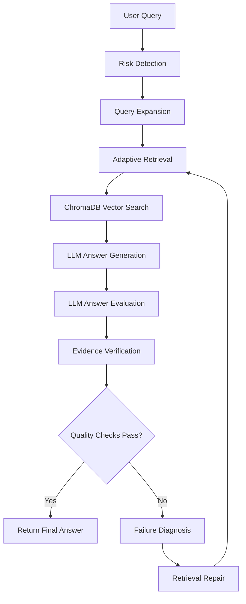

# TrustRAG — Self-Healing RAG System

TrustRAG is a self-healing Retrieval-Augmented Generation (RAG) system designed to improve the reliability of AI-generated answers using adaptive retrieval, query expansion, LLM-based evaluation, evidence verification, and failure diagnosis.

## 🚀 Features

- **Document Ingestion:** Extract and chunk text from PDF documents.
- **Vector Search:** Retrieve relevant document chunks using ChromaDB.
- **LLM Integration:** Generate answers using a locally hosted Ollama model.
- **Adaptive Retrieval:** Expand queries and adjust retrieval when needed.
- **LLM-as-a-Judge:** Evaluate answer relevance, faithfulness, and evidence sufficiency.
- **Evidence Verification:** Check whether generated answers are supported by retrieved context.
- **Self-Healing Workflow:** Diagnose unsuccessful responses and retry retrieval.
- **FastAPI Backend:** Expose the RAG pipeline through API endpoints.
- **Interactive Frontend:** Query documents through a web interface.

## 🏗️ Architecture



## 🛠️ Tech Stack

- **Language:** Python, JavaScript
- **Backend:** FastAPI, Uvicorn
- **RAG & Vector Database:** ChromaDB
- **Embeddings:** Sentence Transformers
- **LLM Runtime:** Ollama
- **Language Model:** Qwen 2.5 3B
- **PDF Processing:** PyPDF
- **Frontend:** Vite-based web application
- **Version Control:** Git and GitHub

## 📂 Project Structure

```text
TrustRAG/
├── api.py
├── requirements.txt
├── data/
│   └── documents/
├── src/
│   ├── ingestion/
│   ├── retrieval/
│   ├── evaluation/
│   ├── risk/
│   ├── query_expander.py
│   └── self_healing_rag.py
├── frontend/
├── chroma_db/
└── README.md
```

## ⚙️ Installation and Setup

### 1. Clone the Repository

```bash
git clone https://github.com/rai8896/TrustRAG.git
cd TrustRAG
```

### 2. Create a Virtual Environment

**Windows PowerShell**

```powershell
python -m venv .venv
.\.venv\Scripts\Activate.ps1
```

### 3. Install Python Dependencies

```bash
pip install -r requirements.txt
pip install "uvicorn[standard]"
```

### 4. Install and Run Ollama

Install Ollama from https://ollama.com/

Pull the required model:

```bash
ollama pull qwen2.5:3b
```

Verify that the model works:

```bash
ollama run qwen2.5:3b
```

Keep Ollama running while using the application.

### 5. Add Documents and Ingest Data

Place your permitted PDF documents inside `data/documents/`.

Run the ingestion script from the project root:

```bash
python -m src.ingestion.ingest
```

**Note:** Check the ingestion script before rerunning it. If it recreates the ChromaDB collection, previously indexed data may be replaced.

### 6. Start the Backend

From the project root, run:

```bash
uvicorn api:app --reload
```

Backend URL: http://127.0.0.1:8000

API documentation: http://127.0.0.1:8000/docs

### 7. Start the Frontend

Open a second terminal:

```powershell
cd frontend
npm install
npm run dev
```

Open the local URL displayed by Vite, commonly:

http://localhost:5173

## 🔍 How It Works

1. The user submits a question.
2. The system detects potential risks and expands the query.
3. Adaptive retrieval searches the vector database.
4. The retrieved document chunks provide context for answer generation.
5. An LLM-based evaluator assesses the generated answer.
6. Evidence checking examines whether the answer is supported by the retrieved context.
7. If configured quality checks fail, the system diagnoses the failure and attempts retrieval repair.
8. The system returns the resulting answer.

## 🧪 Evaluation

TrustRAG includes LLM-based answer evaluation and evidence-checking components.

The current checks are heuristic and do not guarantee factual correctness. In particular, keyword overlap can incorrectly classify a claim as supported when the retrieved context is unrelated to the question.

Future evaluation should measure:

- Answer relevance
- Faithfulness to retrieved context
- Evidence precision and recall
- Unsupported-claim rate
- Correct abstention on unanswerable questions
- Retrieval repair success rate
- Performance compared with baseline RAG

Measured improvements should only be reported after repeatable experiments.

## 🔐 Security

- Never commit API keys, passwords, or `.env` files.
- Do not publish private or confidential documents.
- Exclude virtual environments, `node_modules`, caches, and generated databases unless intentionally required.
- Review staged files before pushing to GitHub.


## 👨‍💻 Author

**Manish Rai**

GitHub: https://github.com/rai8896

## 📄 License

No license has been added yet. Add a `LICENSE` file before distributing the project as open-source software.
